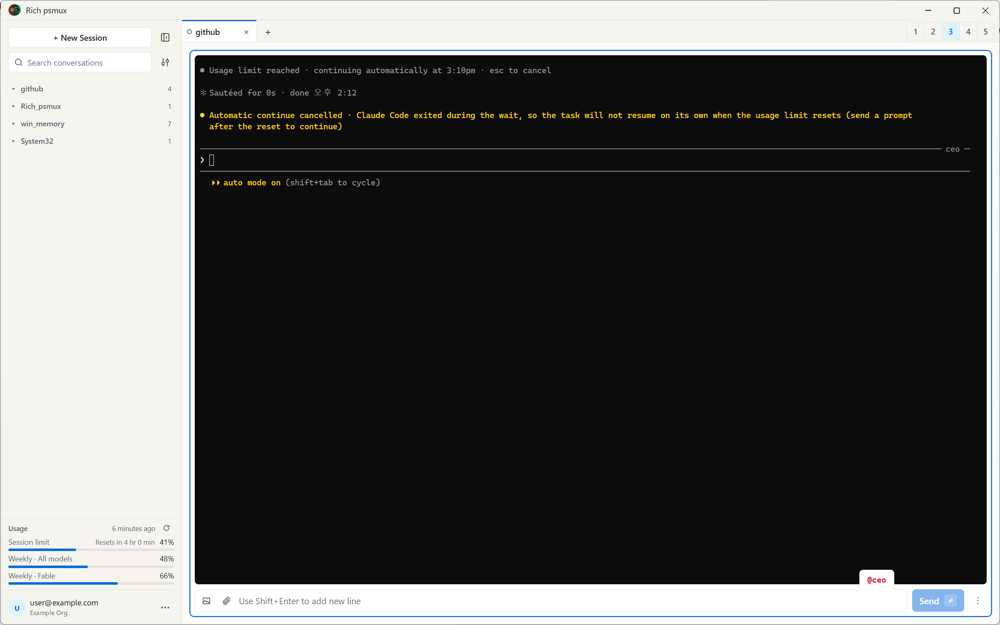
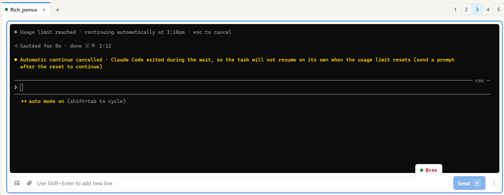
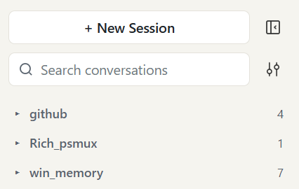
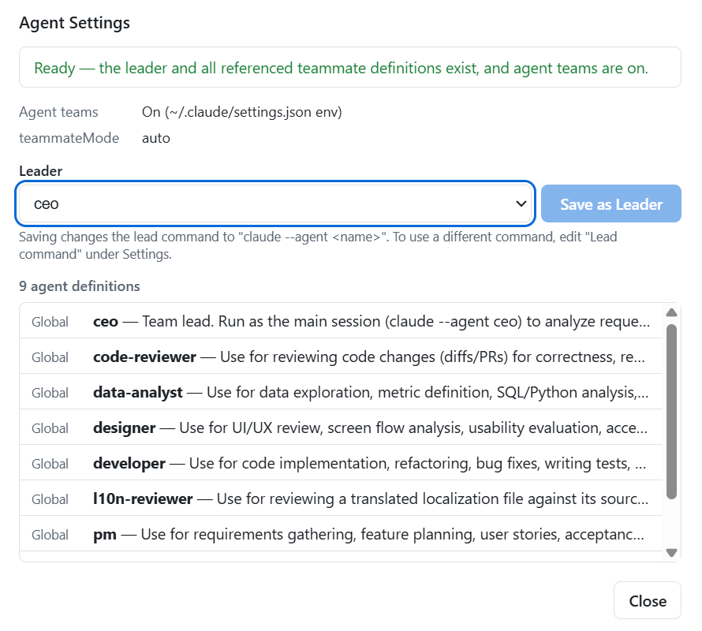
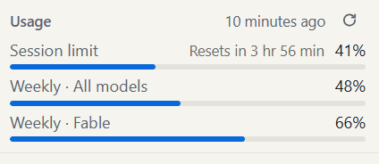
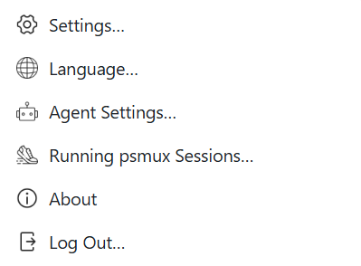

# Rich psmux

**A Windows desktop shell for Claude Code Agent Teams running on psmux.**

[](LICENSE)




> 한국어 요약은 [아래](#한국어-요약)에 있습니다.

## Overview

Rich psmux is a Windows GUI for watching and driving Claude Code **Agent Teams** that run inside [psmux](https://github.com/psmux/psmux), all from a single desktop window.

- **One card = one teammate.** Each card shows that teammate's Claude Code screen (terminal) and has its own input box.
- **One tab = one psmux session** (= one team).
- The app attaches to the session through psmux **control mode**, receives the screen output and sends keystrokes. Claude Code itself still runs inside psmux exactly as usual.

What it does **not** do:

- It does not call the Anthropic API directly and has no conversation engine of its own. It does not handle authentication or billing itself.
  - Exceptions: a usage query (`GET /api/oauth/usage`) once at startup (when logged in) and when you click the usage **↻** button, and login/logout, which simply runs the Claude Code CLI (`claude auth login/logout/status`).
- Files under `~/.claude` are **read only** (conversation history, team configuration, account email/organization, and the login token when usage is queried). The token is never stored, logged, or refreshed.
  - Exception: **deleting** a conversation (after confirmation) moves its `.jsonl` file and conversation folder to the Windows Recycle Bin (never a permanent delete).

## Features

- **New session** — pick a project folder; the app creates a psmux session and starts the lead (default `claude --agent ceo`).
- **Teammate cards** — added automatically (`@name` and team color), layouts with 1–5 cards, a per-card input box (Shift+Enter for a newline). No card header: the `@name` tag sits on the top edge of the input box so the terminal gets the most space.



- **History sidebar** — lists Claude Code conversations from all projects, grouped by folder, with search and a filter (status / recent activity / grouping / sort). Click one to resume it in a new tab. Rename, archive, stop session and delete from the **⋮** menu. Collapse with Ctrl+Shift+B, drag the edge to resize.



- **Tabs** — use several sessions at once; detach (session stays alive) or end. Live sessions are restored when you reopen the app. The **▾** button next to **[+]** starts plain `claude` (no agents) in your home folder, a recent folder, or any folder.
- **Attachments** — drag and drop files/folders, image/file buttons, paste images with Ctrl+V, add folders to the lead with `/add-dir`.
- **Account area** — login email and organization, log in / log out, settings, light / dark / system theme.
- **Agent Settings** — lists agent definitions in `~/.claude/agents` and the project's `.claude/agents` (format errors are flagged), chooses the leader, and checks the teammate definitions it refers to and whether the team feature is on. The app never writes definition files.



- **Usage bars** (session limit / weekly all models / weekly per model) — updated from the statusline of the Claude Code instances the app starts, once at startup, and on **↻** (subscription accounts only). Colors change at 70 % / 90 % / 100 %.



- **31 UI languages** — see below.

## Supported languages

English · 한국어 · 日本語 · 中文（简体） · 中文（繁體） · Español (Latinoamérica) · Español (España) · Português (Brasil) · Français · Deutsch · Italiano · Nederlands · Indonesia · Filipino · Tiếng Việt · Türkçe · Русский · Українська · Dansk · Svenska · Norsk bokmål · Suomi · हिन्दी · বাংলা · தமிழ் · తెలుగు · मराठी · ગુજરાતી · ಕನ್ನಡ · മലയാളം · ਪੰਜਾਬੀ

- Pick one from the account **⋯** menu → **Language…**; it applies to every screen immediately, without a restart.
- Until you pick one, the app follows the Windows display language: an exact match, otherwise the main variant of the same language (e.g. `es-MX` → Spanish (Latin America), `pt-PT` → Portuguese (Brazil), `zh-HK` → Chinese (Traditional), `bn-BD` → Bengali, `no` → Norwegian Bokmål), otherwise English.
- Terminal contents, the card input placeholder and the **[Send]** button are not translated.
- Adding a language takes one dictionary file plus one registry line — see [docs/i18n.md](docs/i18n.md) (in Korean).

## Prerequisites

| Item | Details | Check |
|---|---|---|
| OS | Windows 11 (x64) | `winver` |
| PowerShell 7 | e.g. Microsoft Store install (`%LOCALAPPDATA%\Microsoft\WindowsApps\pwsh.exe`) | `pwsh --version` |
| psmux | `winget install psmux` (a version with control mode support) | `psmux -V` |
| Claude Code | CLI installed and logged in. Environment variable `CLAUDE_CODE_EXPERIMENTAL_AGENT_TEAMS=1`, setting `teammateMode: auto` | `claude --version`, `claude auth status` |
| Agent definitions | `~/.claude/agents/*.md` (e.g. ceo, pm, developer …). If the lead command is `claude --agent ceo`, a `ceo` definition must exist | `Get-ChildItem ~/.claude/agents/*.md` |
| Node.js (recommended) | The hook that detects "waiting for permission approval" runs with `node` from PATH. Without it, a fallback is used that is not verified | `node --version` |

The **Agent Settings** dialog also shows whether the team feature is on and where the flag was found.

## Installation

### Download the installer

1. Download `Rich-psmux-Setup-<version>.exe` from the [Releases page](https://github.com/whisperlip-boop/rich_psmux/releases) and run it. It installs for the current user without administrator rights.
   - The installer is not code-signed, so SmartScreen may warn you (**More info** → **Run anyway**).
   - The setup language follows Windows (Korean or English).
2. The setup wizard:
   - **License** — accept the MIT license.
   - **Prerequisites** — checks for psmux, PowerShell 7, Claude Code and winget. Each missing item gets a checkbox (checked by default) with the command it will run; uncheck it to install the item yourself later.
     - psmux: `winget install --id marlocarlo.psmux -e`
     - PowerShell 7: `winget install --id Microsoft.PowerShell -e` (its own installer may ask for administrator approval)
     - Claude Code: Anthropic's official installer, `irm https://claude.ai/install.ps1 | iex`
   - **Install** — copies the app to `%LOCALAPPDATA%\Programs\rich-psmux`, creates Start menu and desktop shortcuts, then runs the checked items one by one in console windows.
   - **Finish** — shows the result for each item and whether agent definitions (`%USERPROFILE%\.claude\agents`) and Agent Teams are set up. Setup never changes your `~/.claude` settings or environment variables; it only tells you what to do. The log is `%APPDATA%\rich-psmux\logs\installer.log`.
3. Silent install: `Rich-psmux-Setup-<version>.exe /S` installs or updates the app only (no prerequisite checks or installs).
4. **Uninstall:** Windows Settings → Apps → "Rich psmux" → Uninstall. psmux, PowerShell 7, Claude Code and `~/.claude` are not touched. App data (`%APPDATA%\rich-psmux`) is kept; delete it manually if needed.

### Build from source

```powershell
git clone https://github.com/whisperlip-boop/rich_psmux.git
cd rich_psmux
npm install
npm run dist     # → dist\Rich-psmux-Setup-<version>.exe
```

Then run the generated installer.

## Usage

### Quick start

1. Open the app from the shortcut.
2. Click **[+ New Session]**, or **[Select Folder…]** in the middle of the window, and pick a project folder.
3. The lead starts in the first card (default `claude --agent ceo`). Type your request in the card's input box.

### Cards and input

- When the lead spawns teammates, a card is added for each one (`@name`, team color). Choose a layout with 1–5 cards.
- Each card has its own input box. Enter sends, Shift+Enter inserts a newline. The card menu **⋮** is to the right of **[Send]**.

### Tabs

- Each tab is a psmux session; you can run several at once.
- The tab **×** (Ctrl+Shift+W) detaches and keeps the psmux session alive; **End…** in the tab's right-click menu terminates it.
- Exception: a tab that has no conversation yet is **ended** by ×, because there is nothing to come back to and a leftover session would keep the project folder locked. The × tooltip says which will happen.
- **▾** next to **[+]** — "Claude only (no agents)": plain `claude` in your home folder, a recent folder, or a folder you pick. Resuming that conversation from history keeps it agent-free.
- Running teams in several tabs at once multiplies Claude usage by the number of tabs (a warning appears on the tab bar when 2 or more tabs are working).

### History sidebar

- Click a conversation to resume it in a new tab. If the app still has a detached session for it, it reattaches instead of starting a new one.
- **⋮** menu (or right-click / Shift+F10): rename, archive, **Stop Session…** (for a conversation running without a tab), delete.
- **Sessions without a tab** — shown at the top only when they exist: app sessions whose tab was closed but that are still alive and have no conversation yet. Click to reconnect, or **⋮ → Stop Session…** to end it and free the folder.
- Rename and archive are stored in the app only and are not reflected in Claude Code's `/resume` list.

### Attachments

- Drag and drop files or folders onto a card, or use the image/file buttons.
- Paste an image with Ctrl+V (saved as PNG; the path is inserted).
- Add a folder to the lead with `/add-dir`, then pick the confirmation option (1. Yes, for this session …) in the card.

### Account

- The account area at the bottom of the sidebar shows the login email and organization.
- **Log In / Log Out** are in the account **⋯** menu. Log In runs `claude auth login` in a card in a new tab. Logging out does not close open tabs.

### App data

`%APPDATA%\rich-psmux`: `settings.json`, `ui-state.json`, `sessions\`, `hooks\`, `clips\` (pasted images, deleted after 7 days), `logs\app.log`.

## Settings

Account area **⋯** → **Settings…**



<details>
<summary>Settings reference</summary>

| Item | Default | When it applies |
|---|---|---|
| psmux path | Empty = auto-detect from PATH, then the winget default location | From the next new session |
| PowerShell 7 path | Empty = psmux default shell | From the next new session. Applied as `default-shell` for that session only, so every pane starts in this shell. Only `pwsh.exe` or `powershell.exe` are supported |
| Lead command | `claude --agent ceo` (empty = default) | From the next new session |
| History path | `~/.claude/projects` | Reloaded as soon as you save. The app only reads this folder. A drive root is rejected |
| Show SDK (sdk-cli) conversations | Off | Immediately |
| Terminal font / size | `"D2Coding", "Cascadia Mono", Consolas, "Malgun Gothic", monospace` / 13 | Immediately |
| Theme | Light | Immediately (System follows Windows). The terminal area is black in both themes |
| Language (account **⋯** → **Language…**) | Windows display language, matched to a supported language, otherwise English | Immediately, including open dialogs, tabs and app messages |

- Paths are saved only when empty (default) or an existing absolute path; invalid values show an error and are not saved.
- Settings are stored only in the app data folder; nothing is written to `~/.claude`.
- The lead command is rejected if it contains app-reserved options such as `-r`, `-c`, `--settings` or characters such as `&`, `;`, `|`, `#`.
- Save network (UNC) paths one at a time: right after an unresponsive one is checked, another may be rejected for about 20 seconds.

</details>

## Development

| Script | What it does |
|---|---|
| `npm run dev` | Build, then run Electron |
| `npm start` | Run Electron on the existing build |
| `npm test` | Unit tests (vitest) |
| `npm run itest` | psmux integration tests (creates and cleans up real psmux sessions, no Claude calls) |
| `npm run itest:intl` | Checks every UI language's date/number formatting in the real Electron runtime |
| `npm run typecheck` | `tsc --noEmit` |
| `npm run build` | Type check + bundle into `out\` |
| `npm run dist` | Type check + production bundle + NSIS installer → `dist\Rich-psmux-Setup-<version>.exe` |

Requirements: Node.js LTS and npm, plus the [Prerequisites](#prerequisites) to run the app.

| Path | Role |
|---|---|
| `src/main` | Electron main process: psmux control mode client, sessions, history, settings |
| `src/preload` | Minimal API exposed to the renderer |
| `src/renderer` | UI (Preact, xterm.js) |
| `src/shared` | Shared types, i18n dictionaries and pure logic |
| `src/hook` | Hook recorder for "waiting for permission approval" detection, usage statusline recorder |

<details>
<summary>Build and packaging notes</summary>

- Bundling uses esbuild (`scripts/build.mjs`); packaging uses electron-builder (NSIS, no code signing). Hook scripts live outside the asar (`resources\app.asar.unpacked\out\hook`) so an external `node` can read them.
- The installer and window icon is `src/img/logo2.ico`.
- Environment variables used only in development runs (`CTD_USER_DATA_DIR`, `CTD_AUTOSTART_FOLDER`, `CTD_LEAD_COMMAND`, `CTD_TEST_PICK_*`, etc.) are ignored by the installed app.

</details>

## Known limitations

<details>
<summary>psmux behavior differences the app works around</summary>

| Behavior | How the app handles it |
|---|---|
| `send-keys -l` / `-H` are delivered but return `%error command timed out` | That error from these two forms is treated as success |
| Window ID in window notifications is always `@1`; some changes produce no layout notification | Notifications are only a "changed" signal; the real list is re-read with `list-panes` |
| `resize-pane -x/-y` doesn't work or gives a different size | Not used (`resize-window` instead) |
| `-CC -t <name>` ignores the target and creates a new session | Checked with `has-session` first, then `attach -t` |
| `paste-buffer` commands return `unknown command` in control mode | Bracketed paste markers are sent directly with `send-keys -H` |
| `'\''` quoting is not supported; double quotes handle only `\"` and `\\` | Single quotes are split into separate arguments |
| `new-session` inherits the caller's environment variables (SHELL, CLAUDE_*, etc.) | Those variables are cleared when launching psmux |
| With `resize-window -y N`, the pane is sometimes N-1 rows | The real size is read back and the terminal row count is matched |
| `S-Enter` is sent as the same value as `M-Enter` | Claude Code panes use bracketed paste; pwsh panes use `C-j` between lines |
| After a teammate exits, its pane remains with `pane_dead=1` | Only dead panes inside the app's sessions are cleaned up |
| CLI `list-panes -a` also lists panes of other sessions | Only `list-panes -s -t <session>` is used |

</details>

<details>
<summary>Claude Code</summary>

- If the input contains an `@"file path"` reference, Enter may be consumed by autocomplete, so the app sends an `End` key right before Enter.
- `/add-dir` fails if the path is quoted, so the app inserts it without quotes.
- A drive root is inserted as `@"C:/"` (a trailing `\"` may be read as an escape).

</details>

<details>
<summary>Other</summary>

- No code signing (SmartScreen warning).
- The title bar is drawn by the app; the minimize/maximize/close buttons use Electron `titleBarOverlay`. Windows only.
- If the clipboard holds only the `PNG` format without a bitmap, Electron cannot read the image and Ctrl+V does nothing. Most capture tools (Win+Shift+S, etc.) also put a bitmap on the clipboard.
- psmux sessions not created by the app appear by name only in **Running psmux Sessions…** and cannot be attached.
- Deleting a conversation moves the conversation and teammate `.jsonl` files and conversation folders to the Recycle Bin. Conversations that are open in a tab or running cannot be deleted.
- Log In / Log Out use `claude` from PATH (.exe, or .cmd from an npm install). If it cannot be found, the menu items are disabled.

</details>

## License

MIT — see [`LICENSE`](LICENSE).

Open-source software this app uses or works with:

| Component | License | Notes |
|---|---|---|
| [psmux](https://github.com/psmux/psmux) | MIT | Installed separately (not bundled) |
| [Electron](https://www.electronjs.org/) | MIT | Bundled in the installer (`LICENSE.electron.txt`, `LICENSES.chromium.html`) |
| [xterm.js](https://xtermjs.org/) (`@xterm/xterm`, `addon-fit`, `addon-unicode11`) | MIT | Included in the renderer bundle |
| [Preact](https://preactjs.com/) | MIT | Included in the renderer bundle |
| [electron-builder](https://www.electron.build/) | MIT | Build tool (not included in the installer) |
| [NSIS](https://nsis.sourceforge.io/) | zlib/libpng | Generates the installer/uninstaller |

Rich psmux is an independent project. It is not affiliated with, endorsed by, or sponsored by the psmux project or its authors; "psmux" in the name only describes what the app works with. psmux is not bundled or modified — install it yourself (`winget install psmux`); it is used under its own MIT license.

Claude and Claude Code are products of Anthropic. Claude Code is not bundled or redistributed — install it from Anthropic's official channels; it is used under Anthropic's own terms. This project is not affiliated with or endorsed by Anthropic.

---

## 한국어 요약

Rich psmux는 psmux에서 돌아가는 Claude Code **Agent Teams**를 데스크톱 창 하나에서 보고 조작하는 Windows용 GUI입니다. 팀원 한 명이 카드 하나, 탭 하나가 psmux 세션 하나입니다. 앱은 psmux **control mode**로 세션에 붙어 화면을 받고 키를 보내며, Claude Code는 원래대로 psmux 안에서 실행됩니다.

- Anthropic API를 직접 부르지 않고 자체 대화 엔진도 없습니다. 예외: 사용량 조회 `GET /api/oauth/usage`(기동 시 1회 + ↻ 클릭 시), 로그인·로그아웃은 `claude auth login/logout/status` CLI 실행.
- `~/.claude`는 읽기만 합니다. 예외: 대화 삭제 시 확인 후 `.jsonl`과 대화 폴더를 Windows 휴지통으로 옮김(영구 삭제 없음).
- UI 언어 31개 지원: 계정 ⋯ → **언어…**에서 선택하면 재시작 없이 바로 바뀝니다(기본값은 Windows 표시 언어).

### 사전 준비

- Windows 11 (x64), PowerShell 7(`pwsh --version`)
- psmux: `winget install psmux` (control mode 지원 버전, `psmux -V`)
- Claude Code CLI 설치·로그인, `CLAUDE_CODE_EXPERIMENTAL_AGENT_TEAMS=1`, `teammateMode: auto`
- 에이전트 정의 `~/.claude/agents/*.md` — 리드 명령이 `claude --agent ceo`면 `ceo` 정의 필요
- Node.js 권장 — 권한 승인 대기 감지 hook을 PATH의 `node`로 실행

### 설치

1. [Releases](https://github.com/whisperlip-boop/rich_psmux/releases)에서 `Rich-psmux-Setup-<버전>.exe`를 받아 실행합니다. 관리자 권한 없이 `%LOCALAPPDATA%\Programs\rich-psmux`에 설치됩니다. 코드 서명이 없어 SmartScreen 경고가 뜨면 "추가 정보" → "실행".
2. 설치 마법사: MIT 라이선스 동의 → 필수 구성 요소 확인(psmux·PowerShell 7·Claude Code·winget, 없는 항목은 체크하면 앱 설치 후 콘솔 창에서 설치) → 설치 → 완료(항목별 결과, 에이전트 정의·Agent Teams 안내, 로그 `%APPDATA%\rich-psmux\logs\installer.log`). `~/.claude` 설정과 환경 변수는 바꾸지 않습니다. `/S`는 앱만 설치·업데이트합니다.
3. 소스 빌드: `git clone` → `npm install` → `npm run dist` → `dist\Rich-psmux-Setup-<버전>.exe`.
4. 제거: Windows 설정 → 앱 → "Rich psmux". psmux·PowerShell 7·Claude Code·`~/.claude`는 건드리지 않고, `%APPDATA%\rich-psmux`(앱 데이터)는 남으므로 필요하면 직접 삭제하세요.

### 사용법

1. **[+ 새 세션]** 또는 가운데 **폴더 선택…** → 프로젝트 폴더 선택 → 첫 카드에서 리드 실행.
2. 팀원 카드는 자동 추가되며 레이아웃 1~5, 카드별 입력창(Shift+Enter 줄바꿈).
3. 탭은 분리(세션 유지)/종료, 앱을 다시 열면 살아 있는 세션 복원. **[+]** 옆 **▾**는 에이전트 없이 `claude`만 실행.
4. 왼쪽 사이드바에서 대화 검색·필터·⋮ 메뉴(이름 변경·보관·세션 끊기·삭제), 클릭하면 새 탭에서 이어가기. 접기 Ctrl+Shift+B.
5. 첨부: 드래그, 이미지 Ctrl+V, 리드에 `/add-dir`.
6. 계정 ⋯ 메뉴: 설정, 에이전트 설정, 언어, 로그인·로그아웃. 사용량 막대는 자동 갱신, ↻로 수동 갱신(구독 계정만).

설정·알려진 제약·개발 구조의 상세 내용은 위 영어 섹션을 참고하세요.

### 라이선스

MIT — [`LICENSE`](LICENSE). Rich psmux는 독립 프로젝트로, psmux 프로젝트·작성자나 Anthropic과 제휴·보증 관계가 없습니다. 이름의 "psmux"는 함께 동작하는 대상을 나타낼 뿐입니다. psmux(MIT)와 Claude Code(Anthropic 약관)는 이 앱에 포함·재배포되지 않으며 각자 따로 설치합니다.
